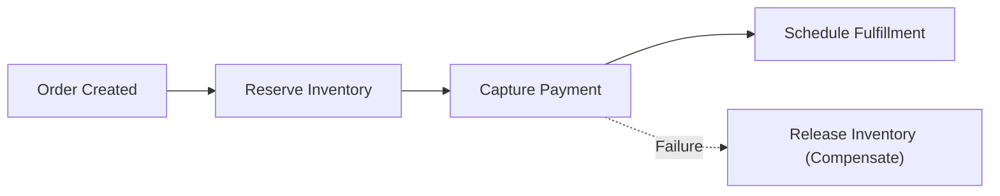

# Saga-Based Order Orchestrator (.NET 9)


**Stack:** `C# 12 · .NET 9 · Distributed Saga Pattern · State Machine`

> [!IMPORTANT]
> **🔒 Enterprise Confidentiality & Clean-Room Reference Notice (For HR & Technical Reviewers)**
> Due to strict **Non-Disclosure Agreements (NDAs)**, SOC2/PCI-DSS security compliance, and proprietary Intellectual Property (IP) governance across enterprise production systems, the full commercial source code, internal infrastructure manifests (Terraform state, Helm charts, internal VPC/IAM topologies), and proprietary third-party adapters cannot be published to public GitHub.
>
> **What is included in this repository:**
> This repository provides a **clean-room, zero-dependency architectural reference core** written from scratch to demonstrate the underlying **domain invariants, state machines, concurrency models, and automated verification suites** without exposing proprietary business logic or client infrastructure. Full architectural walkthroughs and production trade-off discussions are available during technical interviews.

---

## Overview
A deterministic saga orchestration engine managing distributed multi-step order workflows (inventory reservation, payment capture, fulfillment dispatch) with automated reverse-order compensating rollbacks on partial failure.

## Architecture & Execution Flow


## Key Engineering Capabilities
- **Reverse-Order Compensation:** Automatically executes compensating actions in strict LIFO order when a downstream participant fails.
- **Explicit State Transitions:** Tracks `Pending`, `Completed`, `Compensating`, and `Compensated` lifecycle states per step.
- **Idempotent Step Execution:** Prevents duplicate side effects during retry and recovery sequences.
- **Automated CI Verification:** Self-contained `.NET 9` test verification suite run on every push.

## Why a Clean-Room Domain Core?
In enterprise microservices, 80% of production incidents stem from broken domain invariants (race conditions, non-idempotent retries, cross-tenant data leakage, or unbalanced state transitions) rather than HTTP/ORM boilerplate. By isolating the **pure domain engine** from proprietary cloud adapters:
1. **Confidentiality & IP Safety:** Zero proprietary client schemas, credentials, or internal endpoints are exposed.
2. **Deterministic Verification:** Reviewers can clone and execute the full invariant test suite in under 2 seconds (`dotnet run`) with zero external database or cloud setup required.
3. **Clear Architectural Boundaries:** Demonstrates strict separation between domain rules and infrastructure delivery.

## Local Verification
Run the self-contained verification suite locally:

```bash
dotnet run
```

## Documentation
- [Architectural Decisions & Trade-offs](docs/DECISIONS.md)
- [Security, NDA & Isolation Model](docs/SECURITY.md)
