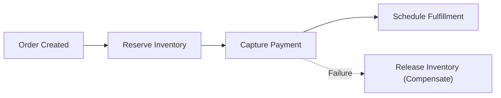

# Saga-Based Order Orchestrator (.NET 9)


**Stack:** `C# 12 · .NET 9 · Distributed Saga Pattern · State Machine`

## Overview
A deterministic saga orchestration engine managing distributed multi-step order workflows (inventory reservation, payment capture, fulfillment dispatch) with automated reverse-order compensating rollbacks on partial failure.

## Architecture & Execution Flow


## Key Engineering Capabilities
- **Reverse-Order Compensation:** Automatically executes compensating actions in strict LIFO order when a downstream participant fails.
- **Explicit State Transitions:** Tracks `Pending`, `Completed`, `Compensating`, and `Compensated` lifecycle states per step.
- **Idempotent Step Execution:** Prevents duplicate side effects during retry and recovery sequences.
- **Automated CI Verification:** Self-contained `.NET 9` test verification suite run on every push.

## Local Verification
Run the self-contained verification suite locally:

```bash
dotnet run
```

## Documentation
- [Architectural Decisions](docs/DECISIONS.md)
- [Security & Isolation Model](docs/SECURITY.md)
